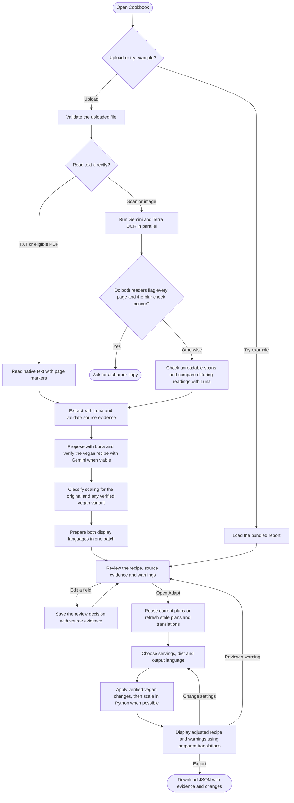

# Finlyt Cookbook Challenge

Cookbook extracts a traceable recipe from a PDF, image, or text file. Review the readings against the source, then change the yield, make the recipe vegan, or combine both. The web app and CLI share the Python pipeline.

## Run the demo

With Docker running, use these commands from the repository root. If you already have a `.env`, skip the copy command. Leave the keys blank for the bundled example. For live imports, fill in `GEMINI_API_KEY` and `OPENAI_API_KEY` before starting the container.

```powershell
Copy-Item .env.example .env
docker build -t finlyt-cookbook .
docker run --rm --env-file .env -p 127.0.0.1:8000:8000 --entrypoint python finlyt-cookbook -m cookbook_ocr.web --host 0.0.0.0
```

Select **Try example**, open the source evidence in **Review**, then set six servings and enable **Make vegan** in **Adapt**. Export the result as JSON. For a live run, place the supplied `Recipe.pdf` in the repository root or select it from its current location. The PDF and `.env` are excluded from Git and the Docker build. [Open the local workspace](http://127.0.0.1:8000/)

## Activity diagram



## Design decisions

| Stage | What I chose and why |
| --- | --- |
| **Ingest** | The Sauerbraten has two photographed pages and no text layer. Its method continues across the page boundary, and the drawings contain readable labels. I preserve page order and keep the header and labels in the readings for review. Docling missed complete ingredient–quantity pairs in my test, so I use Gemini 3.1 Flash-Lite on the original scan and GPT-6.1 Terra on rendered pages, with a PDF fallback above the raster budget. UTF-8 text and eligible digital PDFs go directly to extraction. |
| **Extract** | I chose separate readings and extraction over one image-to-JSON prompt so the reviewer can see where an error entered the result. Luna once read `Bratenstand` for `Bratenfond`. That disagreement left the sauce instruction and its ingredient pending review. Python checks verbatim evidence and page references, ties quantities and units to the ingredient occurrence, and merges exact duplicate detections. Optional ingredients keep their qualifying text. Inferred tools cite a linked action and are labeled. The roast weight and original yield are absent, so both stay unknown. |
| **Manipulate** | Luna proposes substitutions and any changes to the method. Gemini checks the complete vegan recipe. The roast replacement affects the marinade and sauce as well as the ingredient list. I apply the verified vegan changes before scaling so the rules match the recipe being cooked. Python uses exact fractions to update ingredients and linked steps. Fixed or per-batch quantities, disputed measures, and vessel capacity need their own checks. Blind multiplication and preset substitutions would miss these dependencies. |
| **Output** | Review and Adapt show source quotes, corrections, uncertainty, and what changed. I translate for display after anchoring the source fields and reuse those translations with the calculated quantities. Rewriting the recipe on every serving change would make those numbers harder to verify. Export preserves the source, review decisions, plans, and selected result so the adaptation can be replayed. |

With the example's user-supplied baseline of four, the six-serving version scales half a litre each of vinegar and water to **750 mL each** and four onions to **six**. The preparation uses the same values. The roast quantity stays flagged for review.

## Reliability and evaluation

- **Hallucination and trust.** Models read handwriting, interpret steps, and propose changes. Python validates citations, data, and arithmetic. Missing or disputed amounts stay unresolved. Reviewers can inspect the source and correct values or links. `stated`, `inferred`, `missing`, and `needs_review` describe the evidence and review state. They are qualitative signals. Readers can agree on a wrong word, and a valid quote can still conceal an omitted step or a wrong ingredient link.
- **Non-determinism.** Each upload runs the pipeline and model responses can vary. Luna starts extraction at low reasoning effort. When a field fails validation, one targeted request can repair it while preserving the fields that passed validation. Structural failures such as an omitted measured ingredient still trigger one full retry. Saved reports preserve the readings and plans, and replay applies the same transformations in Python. Changing servings or switching between prepared languages within the current upload makes zero model calls.
- **Validation without ground truth.** I tested the German scan, three Portuguese scans and an English text recipe. For an accuracy estimate, I would annotate ingredient–quantity pairs, source spans and step links across clean PDFs, handwriting and degraded scans. Repeat each run and track field accuracy, errors that passed without a flag, and how often review was requested.

| Measured on the two-page Sauerbraten | Time | Estimated API cost |
| --- | ---: | ---: |
| Earlier Gemini + Luna OCR, comparison and extraction | 67.54 s | $0.00467 with observed cache reads |
| Earlier Terra direct-PDF OCR only | 18.09 s | $0.03789 |
| Previous end-to-end import, vegan planning held for review | 3 min 28 s | $0.02309 at observed cache rates, or $0.03107 with cache reads priced as writes |
| Current end-to-end import, including a verified vegan plan and both output languages | 3 min | $0.03232 at observed cache rates, or $0.04036 with cache reads priced as writes |
| Luna extraction and validation within those imports | 108.5 s → 38.6 s | $0.00611 → $0.00245 at observed cache rates |
| Serving change after preparation, Chromium test | About 110 ms | Zero model calls |

In the current run, Terra OCR took 19.4 s, Luna repaired individual fields in 16.6 s after its 22.0 s extraction, and bilingual preparation took 59.5 s. Total cost depends on which adaptations can be prepared. The previous import stopped before vegan planning, while the current one completed it and prepared both languages for both variants. Each row describes an individual measurement. [Benchmark details and pricing sources](AI_LOG.md#2026-11-13-20102022--shorten-luna-extraction-and-repair-field-evidence)

## Examples and tests

| Recipe | Saved outputs |
| --- | --- |
| Sauerbraten | [Extraction](examples/sauerbraten-extraction.json) · [Six servings](examples/sauerbraten-6-servings.json) · [Vegan](examples/sauerbraten-vegan.json) · [Vegan for six](examples/sauerbraten-vegan-6-servings.json) |
| Portuguese scans | [Torta de coco](examples/torta-de-coco.json) · [Casadinhos](examples/casadinhos.json) · [Pé-de-moleque](examples/pe-de-moleque.json) |

With Python 3.10+, install dependencies with `python -m pip install -r requirements.txt`. Then replay the combined example without API keys and run the tests.

```powershell
python -X utf8 -m cookbook_ocr examples/sauerbraten-extraction.json --original-servings 4 --servings 6 --vegan --output outputs/vegan-6.json
python -m unittest discover -s tests -v
```

## With another week

1. Build the annotated set and turn silent extraction errors into regression tests. Benchmark Claude Sonnet as the second visual reader against Terra and assess conventional OCR for printed scans.
2. Split long scans into page batches, verify page coverage against the original, and retry only failed batches. Measure provider cost and latency by stage.
3. Strengthen the link between each amount and its ingredient and step. For financial statements, I would add deterministic unit checks such as EUR versus TEUR and reconcile totals before analyst approval.

[Known problems](PROBLEMS.md) · [AI collaboration log](AI_LOG.md) · [Decision log](DECISION_LOG.md) · [Activity diagram source](docs/activity-diagram.md)
