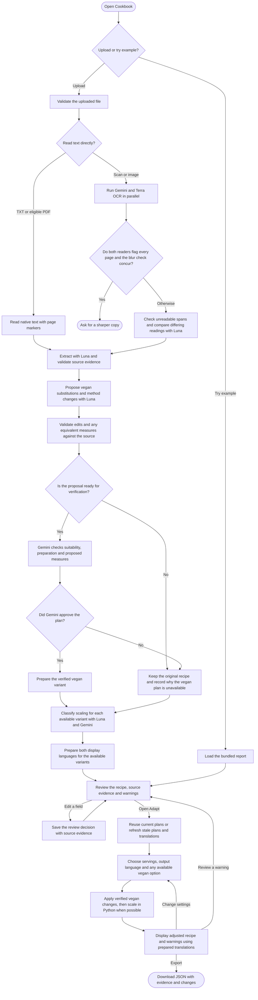

# Cookbook Activity Diagram

The web workflow from import to export. Import prepares the recipe and plans. Review saves human decisions with the source evidence. Adapt uses those decisions and the selected plan.

- Gemini reads the original PDF. Terra receives rendered pages or the original PDF above the raster budget. The blur check requires both OCR readers to flag every page and visual evidence of severe blur.
- Luna can propose a different quantity or unit for a suitable vegan substitute when the source amount is confirmed. Gemini checks the specific equivalence and the final preparation. Adapt displays the reason when a culinary blocker, review issue, or verification failure prevents it from offering a vegan version.
- Scaling uses a stated or user-provided baseline and the measures from the selected variant. Python adjusts linked steps and flags unresolved quantities, batch constraints and vessel capacity when needed.
- Each upload runs the pipeline. Changing servings uses the local Python calculation, and changing the language uses the display output prepared for that upload. Export preserves the original evidence, review decisions and adapted values.
