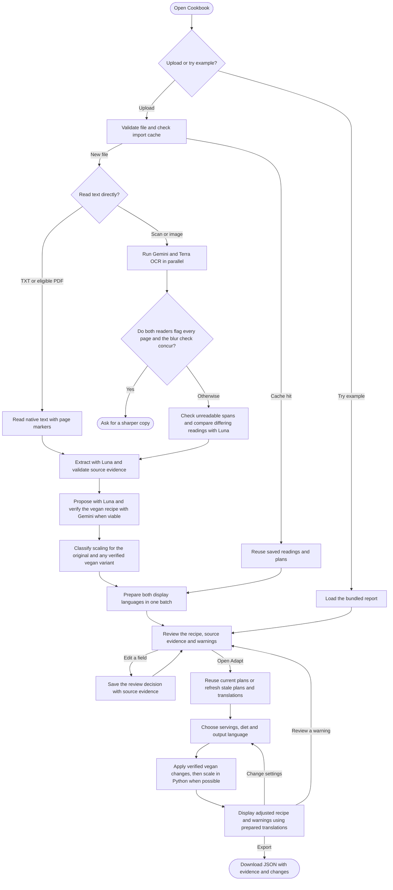

# Cookbook Activity Diagram

The web workflow from import to export. Import prepares the recipe and plans. Review saves human decisions with the source evidence. Adapt uses those decisions and the selected plan.

- Gemini reads the original PDF. Terra receives rendered pages or the original PDF above the raster budget. The blur check requires both OCR readers to flag every page and visual evidence of severe blur.
- The original recipe remains available when the vegan plan cannot be verified. Changing the yield requires a stated or user-provided baseline. The app flags effects it cannot apply safely.
- Changing servings uses the local Python calculation. Changing the language uses the prepared display output. Export preserves the original evidence and review decisions.
