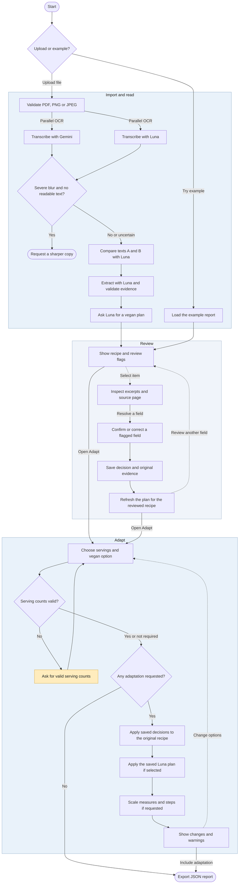

# Cookbook Activity Diagram

Web workflow from recipe import to JSON export.

- For PDF uploads, Gemini receives the file and Luna receives rasterized pages, with a PDF fallback above the local raster budget. Luna compares the two transcriptions, extracts the source recipe, and prepares a vegan plan from the validated fields.
- The blur check can reject an upload only when both readers explicitly report unreadable text on every page and the image check corroborates severe blur. A PDF text layer prevents blur rejection.
- Review keeps the original extraction and evidence alongside the reviewer's decisions. Unresolved fields and document-level alerts remain visible.
- Adapt uses the reviewed recipe when decisions exist. Scaling requires a usable original serving count. Python applies the stored vegan plan before scaling if both options are selected. The export includes the original report, review decisions, the plan, and any adaptation.
