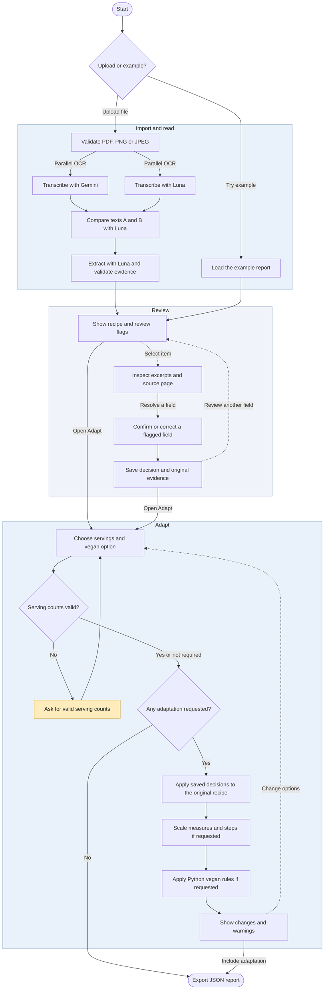

# Cookbook Activity Diagram

Web workflow from recipe import to JSON export.

- For PDF uploads, Gemini receives the file and Luna receives rasterized pages, with a PDF fallback above the local raster budget. Luna compares the two transcriptions before a separate extraction call.
- Review keeps the original extraction and evidence alongside the reviewer's decisions. Unresolved fields and document-level alerts remain visible.
- Adapt uses the reviewed recipe when decisions exist. Scaling requires a usable original serving count. When both options are selected, Python scales first and then applies vegan substitutions and step rules. The export includes the original report, review decisions, and any adaptation.
