# Cookbook Activity Diagram

The web workflow from import to export. Import prepares the recipe and plans. Review saves human decisions with the source evidence. Adapt uses those decisions and the selected plan.

```mermaid
flowchart TD
    start(["Open Cookbook"]) --> entry{"Upload or try example?"}
    entry -->|"Try example"| saved["Load the bundled report"]
    entry -->|"Upload"| upload["Validate the uploaded file"]
    upload --> route{"Read text directly?"}
    route -->|"TXT or eligible PDF"| native["Read native text with page markers"]
    route -->|"Scan or image"| geminiOCR["Gemini 3.1 Flash-Lite reads the original file"]
    route -->|"Scan or image"| terraOCR["GPT-6.1 Terra reads the image or rendered PDF pages, with a direct PDF fallback"]
    geminiOCR --> blur{"Do both readers flag every page and does the local blur check confirm it?"}
    terraOCR --> blur
    blur -->|"Yes"| rescan(["Ask for a sharper copy"])
    blur -->|"Otherwise"| compare["Check unreadable spans and use GPT-6 Luna to compare differing transcriptions"]
    native --> extract["Extract fields with GPT-6 Luna and validate source evidence in Python"]
    compare --> extract
    extract --> veganPlan["Propose vegan substitutions and method changes with Luna"]
    veganPlan --> measures["Validate edits and any equivalent measures against the source"]
    measures --> ready{"Is the proposal ready for verification?"}
    ready -->|"Yes"| verify["Gemini checks suitability, preparation and proposed measures"]
    ready -->|"No"| original["Keep the original recipe and record why the vegan plan is unavailable"]
    verify --> approved{"Did Gemini approve the plan?"}
    approved -->|"Yes"| vegan["Prepare the verified vegan variant"]
    approved -->|"No"| original
    vegan --> scalePlan["Classify scaling for each available variant with Luna and Gemini"]
    original --> scalePlan
    scalePlan --> translations["Prepare both display languages with Luna for the available variants"]
    translations --> review["Review the recipe, source evidence and warnings"]
    saved --> review

    review -->|"Edit a field"| correction["Save the review decision with source evidence"]
    correction --> review
    review -->|"Open Adapt"| current["Reuse current plans or refresh stale plans and translations"]
    current --> options["Choose servings, output language and any available vegan option"]
    options --> apply["Apply verified vegan changes, then scale from the current recipe amounts in Python"]
    apply --> display["Display adjusted recipe and warnings using prepared translations"]
    display -->|"Change settings"| options
    display -->|"Review a warning"| review
    display -->|"Export"| report(["Download JSON with evidence and changes"])
```

- Gemini 3.1 Flash-Lite receives the original PDF. GPT-6.1 Terra receives rendered PNG pages or the original PDF above the raster budget. Both readers receive uploaded images directly. Local blur rejection requires all pages to be available for inspection, both readers to flag every page, and visual evidence of severe blur. PDFs with a detected text layer skip blur rejection.
- Luna can propose a different quantity or unit for a suitable vegan substitute when the source amount is confirmed. Gemini checks the specific equivalence and the final preparation. Adapt displays the reason when a culinary blocker, review issue, or verification failure prevents it from offering a vegan version.
- Scaling uses a stated or user-provided yield and the measures from the selected variant. Python uses numeric quantities supplied in Review as the baseline, checks them against measured steps, and respects supported fixed and per-batch rules.
- Each upload runs the pipeline. Changing servings uses the local Python calculation, and changing the language uses the display output prepared for that upload. Export preserves the original evidence, review decisions and adapted values.
