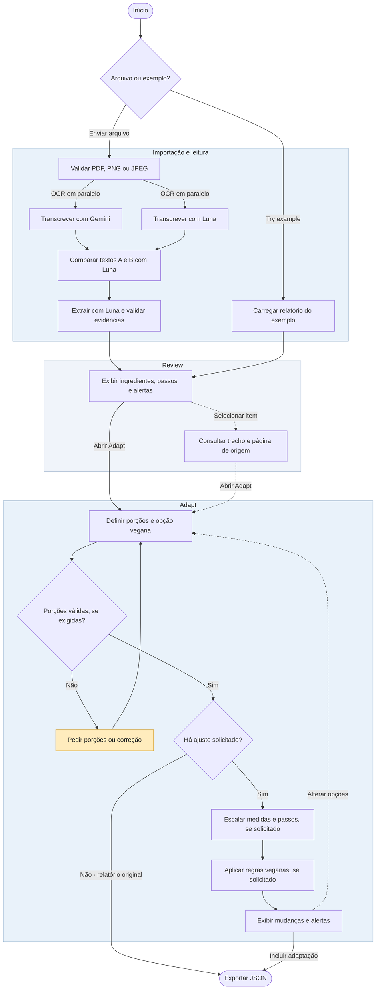

# Cookbook · Diagrama de atividades

Fluxo atual da interface web, da importação ao download do relatório.

- Em PDFs, Gemini recebe o arquivo original. Luna recebe as páginas rasterizadas, com fallback para PDF quando o documento excede o limite local. A comparação começa após as duas transcrições.
- Review permite consultar as evidências e seguir para Adapt com alertas pendentes. Um campo ligado a uma divergência fica sem valor e mantém a evidência para conferência.
- A escala exige uma contagem original confirmada. Adapt reaplica as regras em Python sobre a receita original a cada mudança. O JSON inclui a receita adaptada completa e os avisos que ainda exigem revisão.
